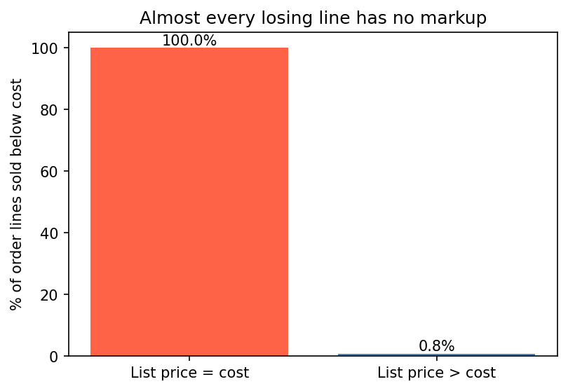
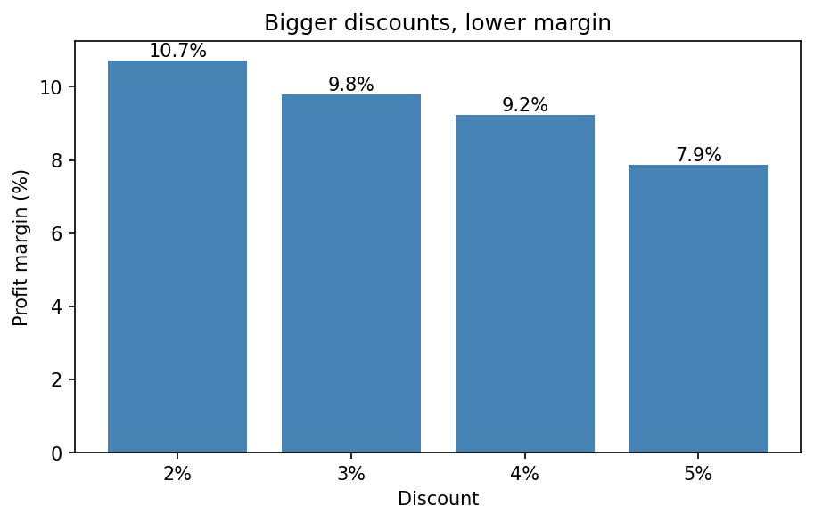
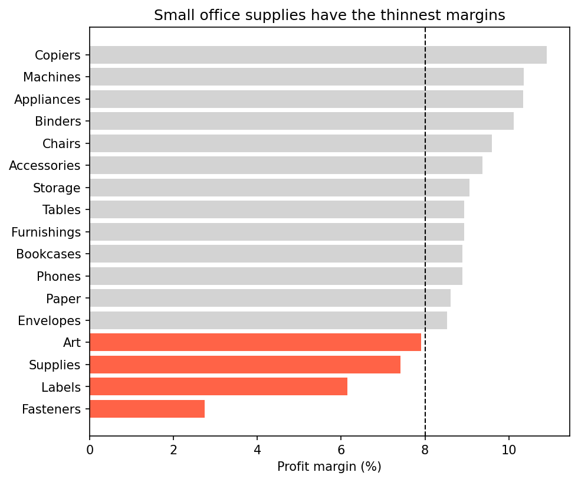
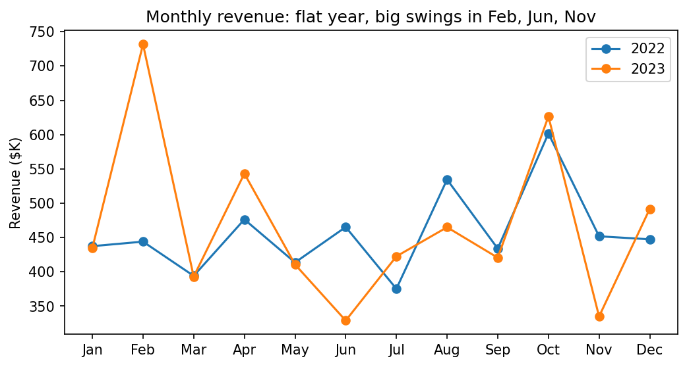

# Retail Orders Analysis

**Question:** Where does this store make money, where does it lose it, and are discounts worth it?

**Tools:** Python (pandas, matplotlib) for cleaning and charts · SQL Server (T-SQL) for analysis

**Data:** [Retail Orders dataset](https://www.kaggle.com/datasets/ankitbansal06/retail-orders) (Kaggle) — 9,994 order lines, US, 2022–2023.

## Process
1. **Cleaning (pandas)** — `order_data_analysis.ipynb`
   - Turned "Not Available" / "unknown" ship modes into missing values
   - Removed 507 rows (5%) with no cost or list price → 9,487 rows
   - Added sale price, profit, revenue and total profit per order line
   - Loaded into SQL Server and checked the row count matched
2. **Analysis (SQL Server)** — `sql/retail_analysis_queries.sql`
   - 10 queries using CTEs, CASE, HAVING, and window functions (`SUM() OVER`, `RANK() OVER (PARTITION BY)`, `LAG`)

## Findings
- **Revenue $11.1M, profit $1.04M, margin 9.4%.** Flat year over year (+2.3%).
- **42% of order lines sell below cost — but it's a pricing setup issue, not a sales issue.** On 3,955 lines the list price equals the cost, so any discount pushes them under. Total loss from these lines is about $11K, ~1% of profit.

  

- **Bigger discounts don't sell more, they just cut margin.** Margin falls from 10.7% at a 2% discount to 7.9% at 5%, with about the same number of orders at each level.

  

- **Small office supplies are the weak spot.** Fasteners (2.7% margin, 91% of lines below cost), Labels (6.1%), Supplies (7.4%) and Art (7.9%).

  

- **Big monthly swings in 2023:** February +65% vs 2022, June −29%, November −26%.

  

## Recommendations
- Review list prices on items where list price = cost, so discounts can't put them below cost.
- Cap discounts at 2–3% — higher discounts didn't bring extra volume.
- Look at pricing for fasteners and labels, or bundle them with higher-margin items.

## Limitations
- Every cost and list price in the data is a multiple of $10, so prices are rounded. That likely creates many of the list price = cost lines.
- Only two years of data, so no long-term trend.
- No customer IDs, so no customer-level analysis.
